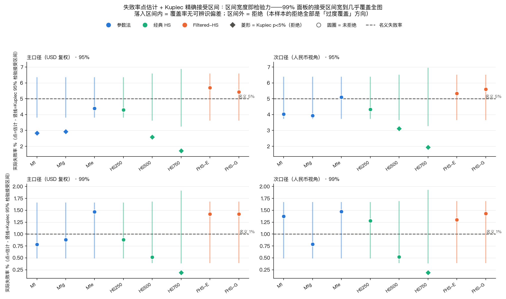
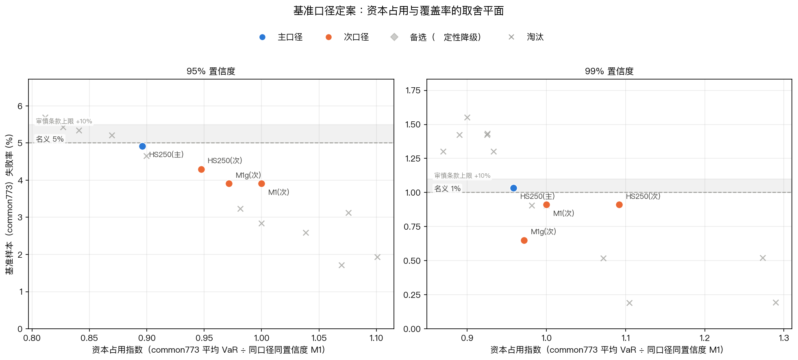
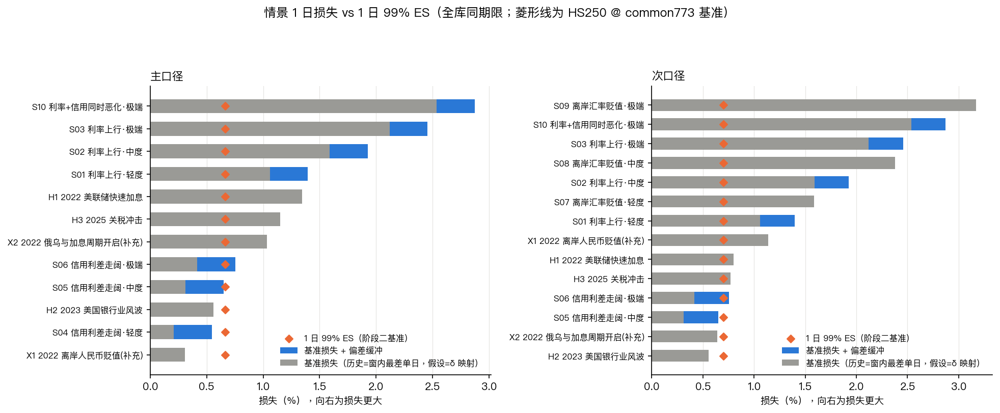
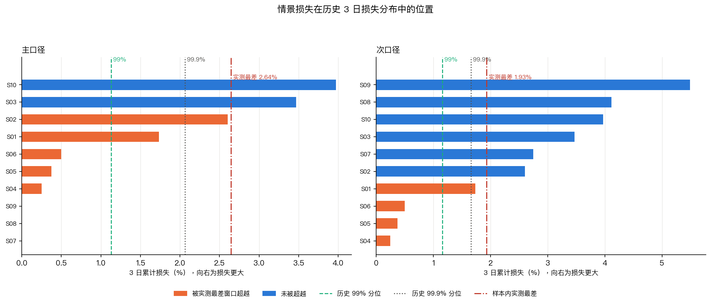
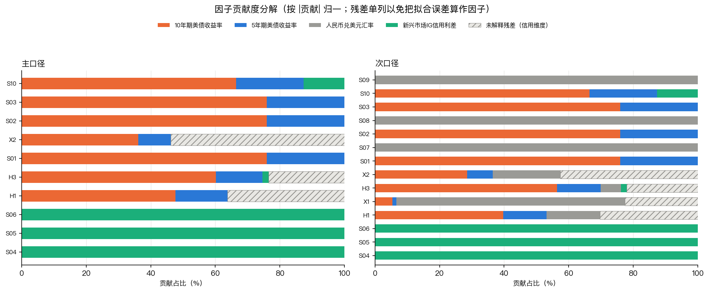
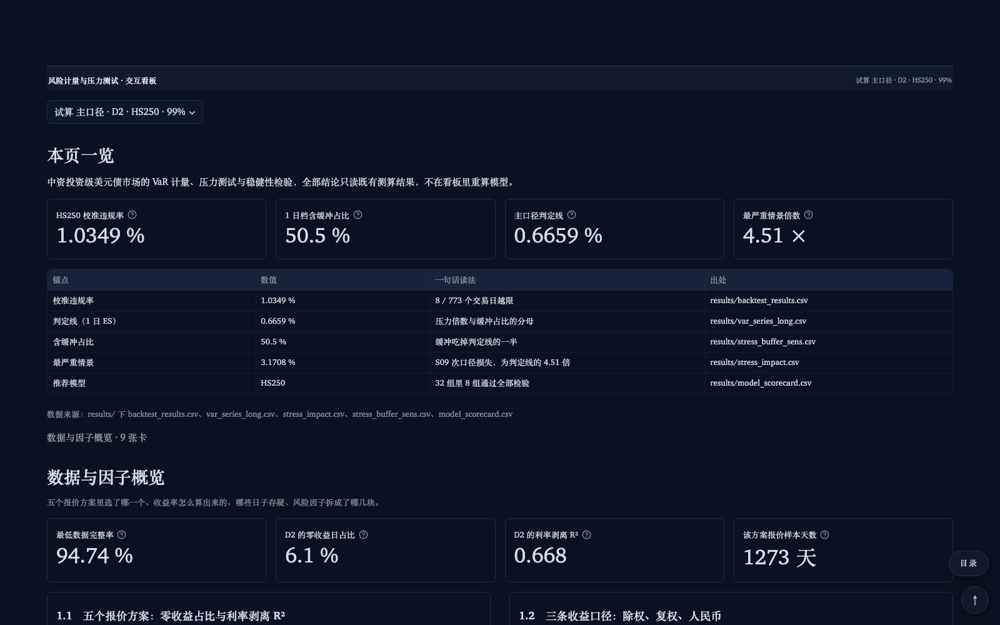
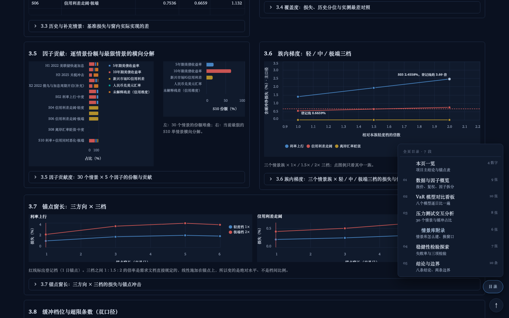
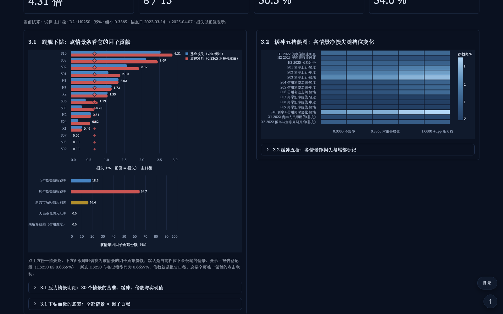

# 中资投资级美元债风险计量与压力测试：项目总结简报

以 9141.HK 美元柜台代理中资投资级美元债组合，用公开数据走完因子拆解、VaR 回测、压力测试与稳健性检验，交付只读交互看板与可复现原型。本材料浓缩终期报告，供结项汇报与部门传阅。

| HS250 校准违规率（773 日） | 1 日 99% 判定线（主 / 次） | 缓冲占判定线 | 最严重情景 |
|---|---|---|---|
| 1.0349% | 0.6659% / 0.7024% | 50.5% | 3.1708%，4.51 倍 |

## 一、项目定位

这是实验性预研，目标是验证方法可行性，产出研究结论与原型工具，不进入生产决策。组合代理取 9141.HK 美元柜台：它有连续日度序列，收益能按利率、信用利差、汇率三条线拆开。范围只含市场风险，损失读数不含流动性折价；持有期 1 日是老师口头指示，需求文档未规定，属自定口径。

## 二、数据与因子

八类公开数据对齐到美股交易日历，全样本 1274 个交易日，因子表 1273 行；样本外主口径 1023 日、次口径 1018 日，横比取公共样本 773 日。

市价序列报价陈旧严重，64.7% 的交易日零收益。比较四种口径后改用官方 NAV 日度序列，零收益日降到 6.1%，反推的 1 日 VaR 比市价口径高约 24%。132 条异常中 16 条无事件支撑，留原值登记，做存疑日两版对照。

因子落成 Δ5Y、Δ10Y、ΔOAS 与 CNY/USD 汇率，信用利差由组合收益对利率回归的残差剥离。复权收益下 R² 为 0.757，等效久期 3.70 年。ΔOAS 自 2023-09 才有值，这一条贯穿全项目。美元本位为主口径，人民币本位为次口径，等于美元收益加汇率收益。

## 三、VaR 与回测

八类模型：参数法 M1、M1g、M1e，历史模拟 HS250、HS500、HS750 与两版滤波 HS。主比较集 32 个配置，全表 262 行。估计窗 250 日、步长 1 日，估计量以 shift(1) 收尾，杜绝前视。

59 处 Kupiec 拒绝全是过度覆盖，无低估，与「尾部容易低估」的先验相反。HS250 在 773 日共同样本上的失败率：主口径 4.92% / 1.03%（95% / 99%）、次口径 4.30% / 0.91%；全样本 1023 日主口径 4.30% / 0.88%。两个 4.30% 分母不同，引用须标样本。

参数法只在 95% 档偏宽；滤波两版以覆盖率为代价省资本，HS750 窗宽失配被拒。基准由 HS250 统管双口径、双置信度四个配置，因两档都准且跨口径成立。其 1 日 99% 期望损失成为判定线：主口径 0.6659%、次口径 0.7024%；全样本无条件 ES 0.8573% / 1.0646% 只作交叉核对。

δ 传导独立验证：1 日窗绝对偏差均值 0.1554pp，90 分位 0.3365pp，取作缓冲；88.1% 来自信用残差。亏损侧 42 个事件窗里 59.5% 低估。δ_fx = +1 是口径搬运，不是拟合参数。

|  |  |
|---|---|
| 图 1　八模型 × 双口径 × 双置信度的失败率与 Kupiec 接受区间。 | 图 2　资本占用与违规率的取舍平面，HS250 落在名义线附近。 |

**表 1　主口径回测摘录（% 为失败率，括号内为违规数 / 有效日）**

| 模型 | 置信度 | 失败率 | 判定 |
|---|---|---|---|
| HS250 | 95% | 4.30% (44 / 1023) | 通过 |
| HS250 | 99% | 0.88% (9 / 1023) | 通过 |
| M1 | 95% | 2.83% (29 / 1023) | 拒绝，过度覆盖 |
| FHS-E | 95% | 5.69% (44 / 773) | 通过 |
| HS250 次口径 | 99% | 1.28% (13 / 1018) | 通过 |

## 四、压力测试

15 个情景、30 条读数：3 个历史、2 个补充、10 个假设。锚点取全样本单日极值，与 VaR 同为 1 日期限。缓冲 0.3365pp 只施加于假设情景。



图 3　15 个情景的 1 日损失与 99% 期望损失判定线；汇率三档在次口径下整块跳出。

主口径最深 S10（利率与信用同时极端）2.5363%，次口径最深 S09（纯汇率极端）3.1708%，为判定线 0.7024% 的 4.51 倍，全表最高，纯汇率情景不加缓冲。历史情景以窗内最差单日为基准，H1 为 1.3449%；次口径最差 1.4739% 也低于 S09，1 日覆盖双口径成立。X1 是唯一主次方向相反的情景（0.3084% / 1.1382%），因它是纯离岸人民币贬值事件。

主判定线下 30 条读数有 19 条超限。缓冲五档（0 / 0.1997 / 0.3365 / 0.8390 / 1.0000pp）下超限条数为 17 / 17 / 19 / 23 / 23。原因在分母：缓冲占判定线的比例从 3 日口径的 40.2% 升到 1 日口径的 50.5%，判定线一半由缓冲构成。

1 日重做翻转三条结论：缓冲敏感性由稳健变为不稳健；信用路径由口径依赖变为双口径同向，但阈值降幅 59% 快于损失降幅 33%，信用维度仍是参考项；次口径尾部只在多日期限更薄，1 日档反而更厚，机制是汇率与债券收益相关 −0.225。

|  |  |
|---|---|
| 图 4　库内最深情景与样本内实测最差单日的对照。 | 图 5　各情景的因子贡献份额，未解释残差单列。 |

读图 5 要带两条边界：历史情景的残差是拟合误差，不等于信用风险；纯汇率情景在次口径下贡献 100% 是口径定义，多因子情景里汇率实际贡献约 20% 到 25%。纯汇率情景在主口径的零损失同样是美元本位的定义。

**表 2　情景损失摘录（%，正值 = 损失）**

| 情景 | 主口径 | 次口径 | 读法 |
|---|---|---|---|
| S10 | 2.5363 | 2.5363 | 库内最深，利率与信用同时极端 |
| S09 | 0.0000 | 3.1708 | 纯汇率极端，次口径 4.51 倍 |
| H1 | 1.3449 | 0.8019 | 2022 加息窗，窗内最差单日 |
| X1 | 0.3084 | 1.1382 | 纯离岸人民币贬值，方向相反 |

## 五、稳健性

六项检验：情景覆盖、窗口平移、缓冲、信用区间、锚点窗长、阈值口径。±2 日平移下十个「情景 × 口径」组合有三个不动，其余需带区间；锚点窗长 3 / 5 / 6 日的极端档极差在汇率方向达 3.9580pp，绝对水平只作量级参考。违规率 1% 时 LR_ind 在 1023 日上只拒绝 1.56%，未拒绝不等于无聚集；滤波未改善经典 HS；次口径 GARCH 有 133 次重估落到边界。HS250 在两口径、两置信度都通过 Kupiec，推荐不是偶然。

## 六、交互看板

看板是单页长文档，七段、五十张卡片、七十七张图、四十七个抽屉，只读既有 CSV，不重算模型。右上角 chip 有五个全局参数：口径、报价方案、模型、置信度、缓冲档；改任一项，全页一起换。2.4 勾行切换整页模型，3.1 点情景条切换因子贡献图。右下角目录覆盖七个锚点，回到顶部常驻，可部署到 Streamlit Cloud。

|  |  |
|---|---|
| 图 6　封面四个数字与出处表，右下角是目录与回到顶部。 | 图 7　目录面板展开，编号与正文卡号前缀对齐。 |



图 8　3.1 旗舰下钻：点情景条，下方因子贡献图跟着换；右栏是缓冲五档热图。

## 七、结论与边界

结论分三层。稳健的：利率是主口径尾部的主要来源，汇率是次口径尾部的主要来源，1 日库级覆盖双口径成立，S10 等于 S03 加 S06 的线性累加。参考的：信用维度整体、假设情景的绝对水平、历史情景的个别读数。不可外推的：δ 对信用情景的传导、2022 年残差代理、历史极值 2 倍的极端档、汇率只给方向。

边界六条：只有 3 次历史与 2 次补充情景且窗间不独立；ΔOAS 自 2023-09 才有值；极端档按定义无法验证；危机窗 12 天全在样本内，样本外命中 0 天；汇率路径不给幅度可靠性；1 日持有期是自定口径。

## 八、复现

Python 3.9，仓库根执行 `python code/run_all.py --clean`，19 步 52 秒重建 48 件产物逐字节一致。看板从根启动：

```
.venv/bin/streamlit run dashboard/app.py
```

默认打开 http://localhost:8501。
